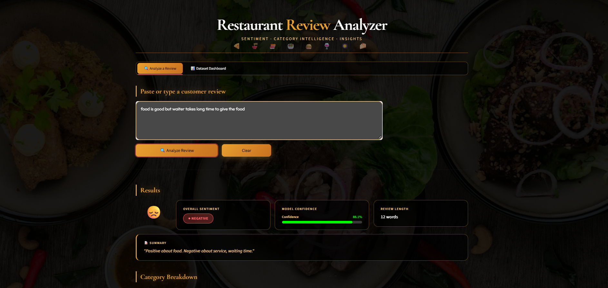
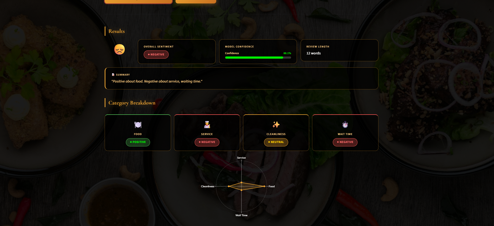

# 🍽️ Restaurant Review Analyzer


A web app that reads a restaurant review and shows the **overall sentiment** and a **category-level breakdown** for food, service, cleanliness and waiting time.

## 📸 Screenshot




## ✨ Features

- Overall sentiment (positive / negative / neutral) with a confidence score
- Category breakdown: food, service, cleanliness, wait time
- Short summary built from the category results
- Radar chart of category sentiment
- Dashboard tab that analyzes a set of sample reviews

## 🔍 Example

**Review:** *"Food is good but waiter takes long time to give the food"*

| Category | Result |
|---|---|
| Food | Positive |
| Service | Negative |
| Wait time | Negative |
| Cleanliness | Neutral |

The overall model gives one label for the whole text. The category breakdown shows what was good and what was bad in the same review.

## 🧠 How it works

1. **Sentiment:** a pre-trained Hugging Face model (`distilbert-base-uncased-finetuned-sst-2-english`) classifies the text.
2. **Categories:** the review is split into sentences. Keyword rules find the sentences that talk about each category, and the same model scores those sentences.
3. **Summary:** built from the category results.

## 🛠️ Tech stack

| Part | Tool |
|---|---|
| Backend | FastAPI, Uvicorn |
| Frontend | Streamlit, Plotly |
| Model | Hugging Face Transformers (PyTorch) |

## 📁 Project structure

```
backend/    FastAPI app (main.py) and requirements
frontend/   Streamlit app (app.py) and requirements
analyzer.png    Screenshot: analyze a review
analyzer1.png   Screenshot: dashboard
README.md
```

## 🚀 Run locally

```bash
# Terminal 1 - backend
cd backend
pip install -r requirements.txt
uvicorn main:app --reload

# Terminal 2 - frontend
cd frontend
pip install -r requirements.txt
streamlit run app.py
```

The first run downloads the model, so you need an internet connection. Open http://localhost:8501.

## 🔌 API

| Method | Endpoint | Description |
|---|---|---|
| POST | `/analyze_review` | Analyze one review |
| GET | `/batch_analysis` | Analyze the sample reviews |
| GET | `/health` | Health check |

## ⚠️ Limitations

- The model gives only positive or negative for each text
- Categories depend on a fixed keyword list
- The dashboard uses a small set of sample reviews, not a full dataset

## 🔮 Future improvements

- Zero-shot classification instead of fixed keywords
- Load a real review dataset for the dashboard